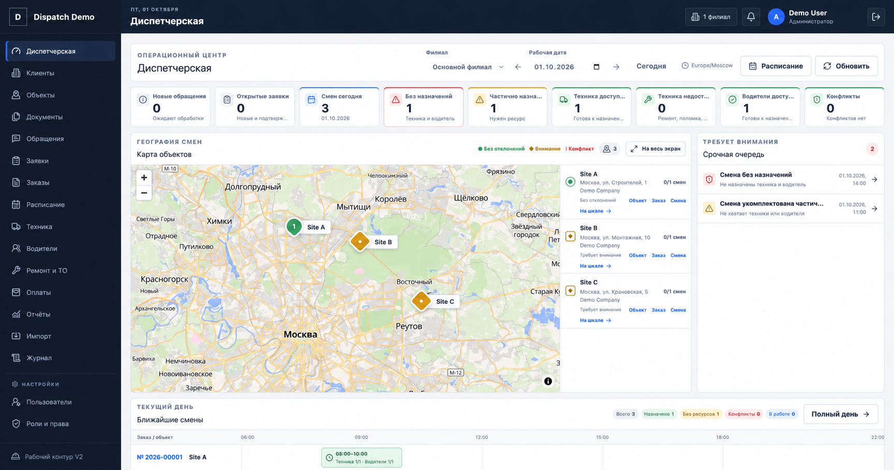

<a href="README.md">English</a> · <a href="README.ru.md">Русский</a>

<h1 align="center">Диспетчерская техники</h1>

Рабочее пространство для координации техники, расписаний и заявок.

   

Публичная витрина закрытого проекта. Здесь представлены обезличенные интерфейсы и основные сценарии; исходный код и внутренние материалы остаются приватными.

## Основные сценарии

- Обзор доступности техники
- Координация на карте
- Заявки и планирование

## Галерея

Каждый экран показан отдельно с сохранением пропорций. Названия, контакты и данные заменены демонстрационными. Это визуальная презентация, а не подтверждение доступности рабочей службы.

Часть изображений обезличена с помощью AI.

### Обзор рабочего пространства

---

[Все проекты](https://github.com/svllvsx)
